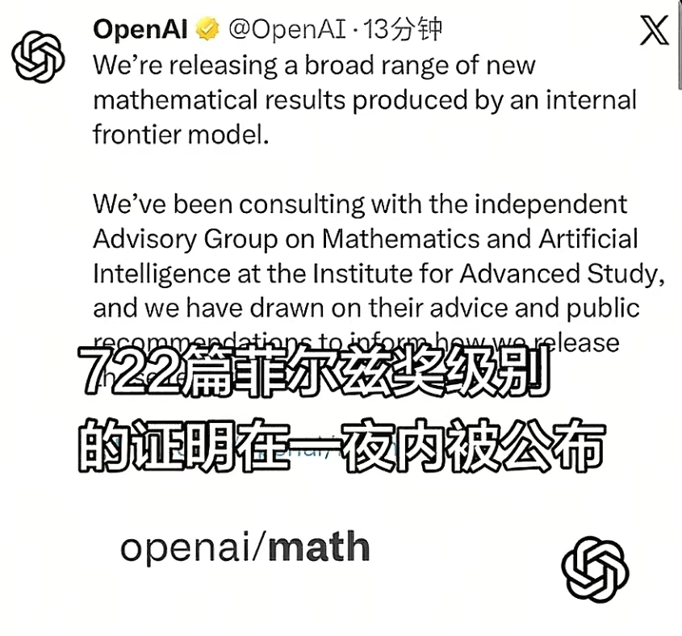

#### 选择大于努力。在AI快速发展的今天，蓝领工作或许是一种更好的选择。

---
## 一、起因

最近和本科同学聊了一会儿。她硕博连读转了方向，转到了计算化学，想往 AI 靠一靠。至于为什么转方向，她说老板把她做的课题给了她师姐，已经读了三年，果断跑路。她来问问我计算化学怎么快速入门。

## 二、计算化学的两条路

计算化学分两块：一个是算法开发，另一个是应用计算。算法开发要难很多，要学 coding、物理公式，以及化学相关的内容。应用计算要简单一些，主要是会用软件处理对应体系下的化学问题。我看了她要转入的老板的主页，应该是主要围绕化学机理做研究的，属于后者。应用计算学习软件很快的，大概半年就会很熟练。至于 AI 结合，我觉得比较难，老板主页没写AI相关的内容明显是化学出身，课题组应该没有什么相关的资源，自己探索难度较大。

## 二、计算化学与AI

然后聊到我去年其实也想读计算化学的博士，但最后还是选择了去制造业做研发（其实是换个地方做实验）。这两天部长还问我，没有读博后悔了没有，我说没有。当工作越局限于屏幕上的内容时，你离 AI 的距离就越近，当然你可以用 AI 加速你的工作内容，另一个是 AI 也会取代一部分工作，并且取代得越来越快。

让我改变读博看法的是一个视频。说现在不建议普通人在 AI 赛道卷。GitHub 每天都会出现很多新项目，当项目做大、功能很好用的时候，就可能被 AI 模型集成到自身的功能上，被 AI 生态“收编”。这就好比开面包店，每天都有新的面包店开张，而且做的面包一个比一个好，种类一个比一个多，让人眼花缭乱。这时候我们就不要再去做面包店，而是去做种小麦、磨面粉、买面包的人。换一种赛道，会让你的工作节奏慢下来，而且短时间内不会被 AI 替代。

而应用计算这个领域，现在已经出现了很多“面包店”，只需要描述你的需求，Agent 就可以很快地自动计算。虽然建模等一些复杂的工作还需要人协助，但不久将来就可以预见，纯做应用计算的人才市场需求会越来越少。

### 26-10-07 补档：

既 Coding 之后，数学也被AI占领。OpenAI 放出 722 篇高阶数学证明：[openai/math](https://github.com/openai/math/tree/main/)

